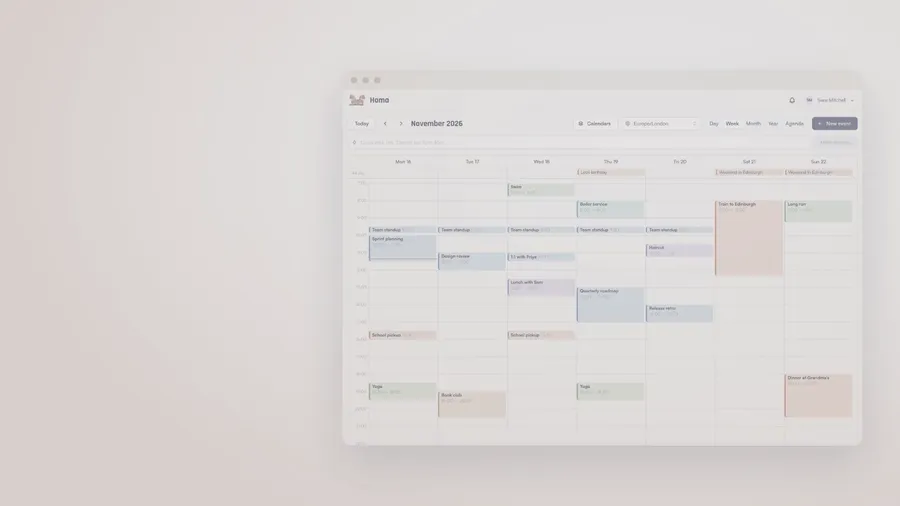
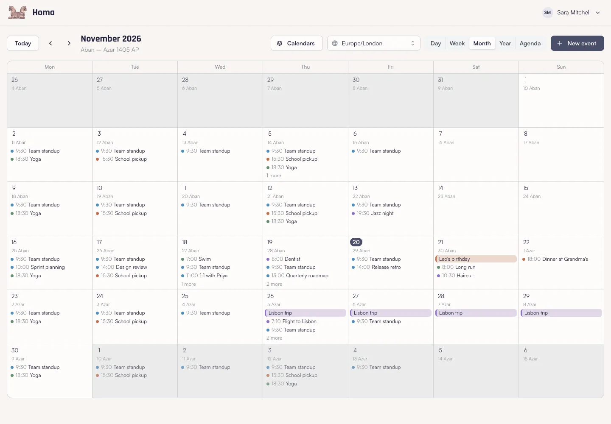
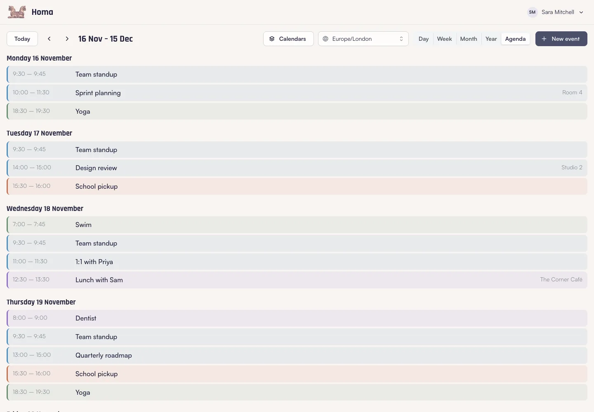
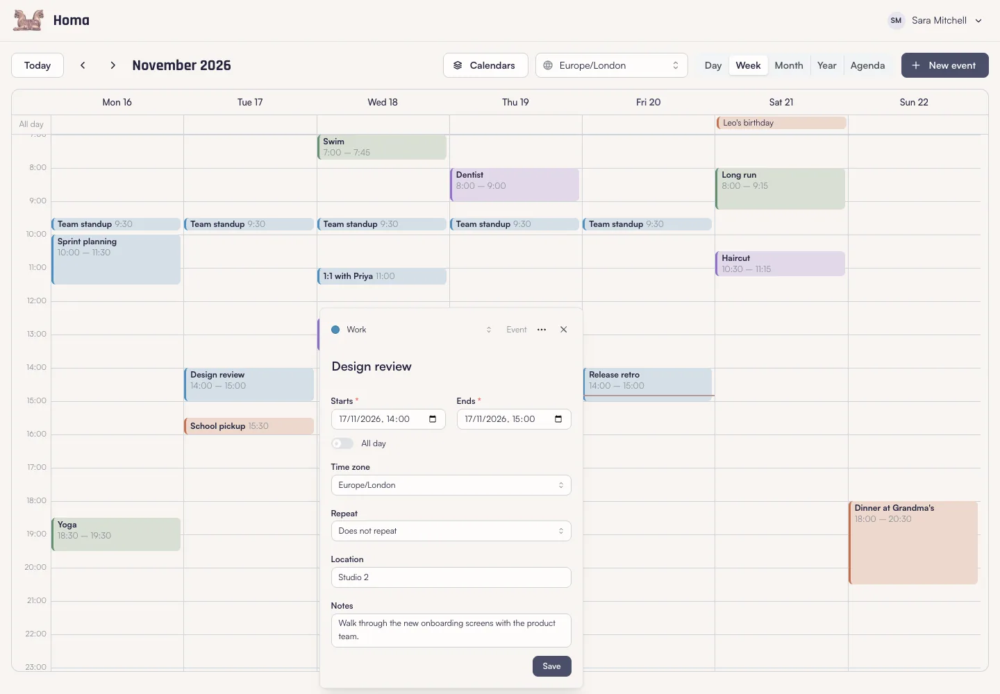
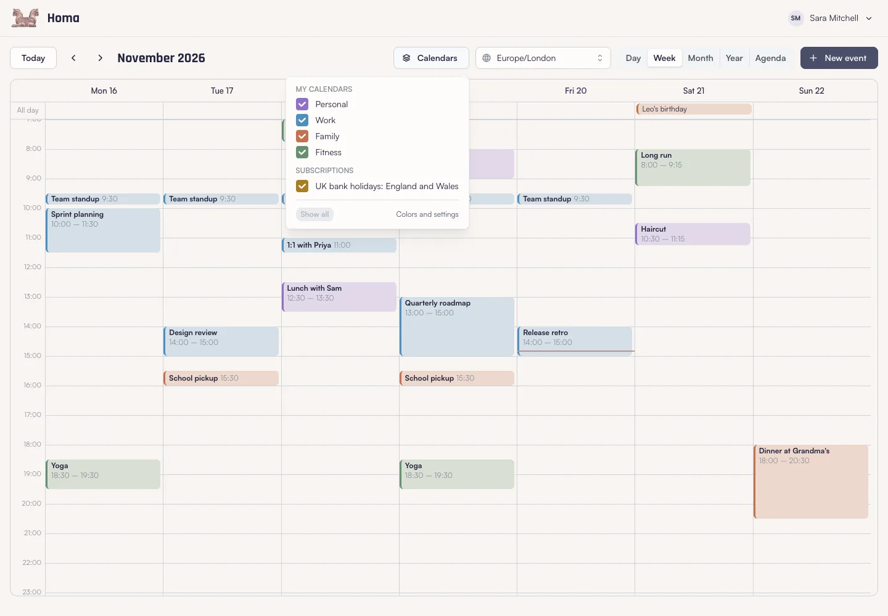
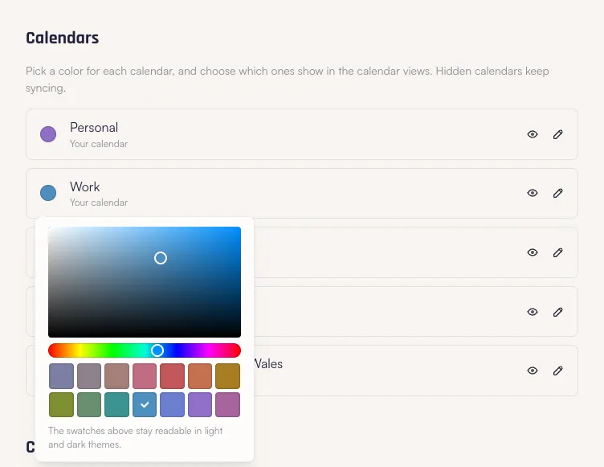
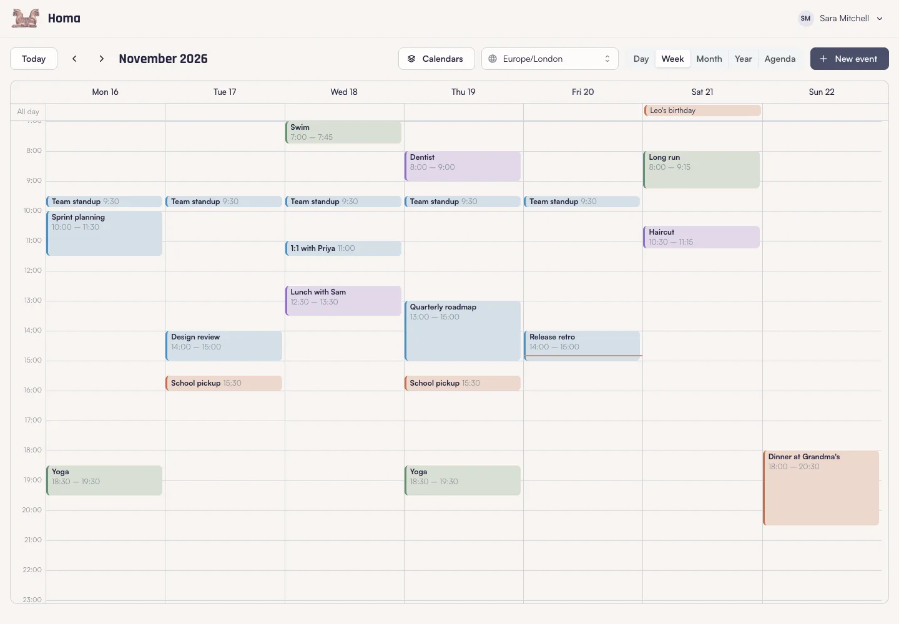

<p align="center">
  
</p>

<h1 align="center">Homa</h1>

<p align="center">
  <strong>A self-hostable calendar that puts every calendar you use on one timeline.</strong><br />
  Two-way sync with CalDAV (iCloud, Fastmail, Nextcloud), Google and Microsoft, ICS subscriptions,
  recurring events, a Jalali second calendar, and English and Farsi with full right-to-left support.
</p>

<p align="center">
  <a href="LICENSE"></a>
  <a href="https://github.com/arsamsarabi/homa/actions/workflows/ci.yml"></a>
  <a href="https://bun.sh"></a>
  <a href="https://hono.dev"></a>
  <a href="https://react.dev"></a>
  <a href="https://www.postgresql.org"></a>
  <a href="https://scorecard.dev/viewer/?uri=github.com/arsamsarabi/homa"></a>
  <a href="deploy/docker/compose.yaml"></a>
</p>

<p align="center">
  <a href="#features">Features</a> ·
  <a href="#quick-start">Quick start</a> ·
  <a href="#configuration">Configuration</a> ·
  <a href="#development">Development</a> ·
  <a href="#architecture">Architecture</a> ·
  <a href="#docs">Docs</a> ·
  <a href="#screenshots">Screenshots</a> ·
  <a href="#roadmap">Roadmap</a> ·
  <a href="#license">License</a>
</p>

<p align="center">
  <a href="docs/media/homa-promo.mp4">
    
  </a>
  <br />
  <sub><a href="docs/media/homa-promo.mp4">Watch the 33-second tour (MP4)</a></sub>
</p>

<details>
<summary><strong>AI-assisted development</strong></summary>

<br />

Development used AI tooling under staff-engineer supervision (~20 years experience, 13 commercial). Architecture, logic, CI/CD, tests, and coverage were reviewed by the maintainer. AI accelerated implementation; technical decisions and review remained human-owned.

</details>

---

## Overview

Homa is a calendar you run yourself: one Docker Compose stack with the app, a background worker and Postgres. Today it is a full calendar with two-way sync, so the calendars you already keep in iCloud, Google, Outlook or on a CalDAV server show up side by side and stay in step.

It is early: pre-v1 and built in phases, and the database and API can still change between versions (upgrade steps are listed in the [changelog](docs/CHANGELOG.md)). The plan goes further than a calendar: reminders, tasks, routines, sharing between people on one instance, and finding a date that works for a group. See [Roadmap](#roadmap).

---

## Features

Built and on `main` today:

| Area | What you get |
| --- | --- |
| **Views** | Day, week, month, year and agenda, with drag to create, move and resize events |
| **Recurrence** | Repeating events with per-occurrence changes, and "this / this and following / all" edits |
| **Time zones** | A home zone for all views, viewing in any other zone, and a time zone per event |
| **Jalali calendar** | Optional Solar Hijri dates beside the Gregorian ones, with Persian occasions (Nowruz, Sizdah Bedar, Chaharshanbe Suri, Yalda) |
| **Languages** | English and Farsi, with the whole interface mirrored right to left in Farsi |
| **Subscriptions** | Read-only ICS feeds by URL, and a catalog of public-holiday feeds to subscribe to in one click |
| **Two-way sync** | CalDAV (tested with iCloud; Fastmail, Nextcloud and Radicale use the same code), Google Calendar and Microsoft (Outlook.com, Microsoft 365). Local changes go out through an outbox; on a conflict the server's copy wins and you see a notice |
| **Calendar filter and colors** | Show or hide each calendar in the views, and pick a color per calendar from swatches that stay readable in both themes |
| **Week start** | Choose the first day of the week, or follow the language (Monday, or Saturday in Farsi) |
| **Import and export** | Import `.ics` files from Google, Outlook, iCloud and others; export everything you own as one JSON file |
| **Instance admin** | The first account becomes the admin, protected by a one-time setup code from the server log. The admin sets the instance name, open or closed sign-ups, the default language and the defaults for new accounts |
| **Self-hosting** | One image in two roles (API and worker) plus Postgres, with Docker Compose. Migrations run on start |
| **API** | REST API with a generated OpenAPI document at `/api/openapi.json`, and a typed client generated from it |
| **Themes** | Light and dark, following the system setting or switched by hand |

---

## Quick start

Compose pulls the published image, `ghcr.io/arsamsarabi/homa`, for amd64 and arm64. You need Docker with Compose v2, `git` and `openssl`.

```sh
git clone https://github.com/arsamsarabi/homa.git
cd homa
echo "BETTER_AUTH_SECRET=$(openssl rand -base64 32)" > deploy/docker/.env
echo "HOMA_ENCRYPTION_KEY=$(openssl rand -base64 32)" >> deploy/docker/.env
echo "HOMA_VERSION=0.3.0" >> deploy/docker/.env
docker compose -f deploy/docker/compose.yaml up -d --wait
```

Open <http://localhost:3000>. The first account you create becomes the instance admin. Creating it asks for the 4-digit setup code that the API prints in its log at start:

```sh
docker compose -f deploy/docker/compose.yaml logs api | grep 'first-run setup code'
```

`HOMA_VERSION` pins the release you run (see [Releases](https://github.com/arsamsarabi/homa/releases)); images are signed with cosign. Keep `deploy/docker/.env` with your backups: losing `HOMA_ENCRYPTION_KEY` means adding every connected calendar again. Upgrades, checking the image signature, backups and running behind a reverse proxy are covered in [Operations](docs/self-hosting/operations.md).

---

## Configuration

Set these in `deploy/docker/.env` for Compose, or in `.env.local` at the repository root for development. The ones most installs need:

| Variable | Required | Default | Meaning |
| --- | --- | --- | --- |
| `BETTER_AUTH_SECRET` | **Yes** | | Signs sessions and tokens. At least 32 characters (`openssl rand -base64 32`). Changing it signs everyone out |
| `DATABASE_URL` | **Yes** (development) | Set by Compose | Postgres connection string |
| `HOMA_ENCRYPTION_KEY` | Once anyone connects a calendar | | Encrypts connected calendars' credentials at rest. 32 bytes, base64 (`openssl rand -base64 32`). With connections saved, the server won't start without it |
| `HOMA_URL` | Behind a proxy | `http://localhost:3000` | The address people use to reach Homa. Sign-ins from any other origin are refused |

Every variable, including sync, Google, Microsoft, web push and the Compose-only ones, is in [Environment variables](docs/self-hosting/environment.md).

---

## Development

You need [Bun](https://bun.sh) 1.4 and Docker. `bun run dev` brings up Postgres, [Mailpit](https://mailpit.axllent.org), the API, and Vite in one Compose stack.

```sh
bun install
cp .env.example .env.local   # set BETTER_AUTH_SECRET
bun run dev                  # web http://localhost:5180 · API :3000 · Mailpit UI :8025
```

To run the API and web on the host instead (deps only in Docker): `bun run dev:deps` then `bun run dev:app` (uncomment `HOMA_SMTP_*` in `.env.local` for Mailpit).

The server applies pending migrations when it starts. The API answers on `/api/health`, and its OpenAPI document is at `/api/openapi.json`. Invite and account emails land in the Mailpit UI at <http://127.0.0.1:8025>.

| Command | What it does |
| --- | --- |
| `bun run dev` | Compose: Postgres, Mailpit, API, and Vite |
| `bun run dev:deps` | Compose: Postgres and Mailpit only |
| `bun run dev:app` | API and Vite on the host (needs `dev:deps`) |
| `bun run test` | Unit and integration tests in every package. Set `TEST_DATABASE_URL` to a Postgres server to include the database tests, and `TEST_CALDAV_URL` to a Radicale server for the CalDAV tests |
| `bun run typecheck` | TypeScript in every package |
| `bun run lint` | Biome lint and format check (`bun run format` fixes) |
| `bun run e2e` / `bun run e2e:smoke` | Playwright against `BASE_URL` (default `http://localhost:3000`), with `HOMA_SETUP_CODE` for a new instance |
| `bun run openapi` | Regenerates `packages/api-client` after an API route or schema change |
| `cd packages/db && bun run generate <name>` | Generates a migration after a schema change |

Contributor guidelines are in [CONTRIBUTING.md](.github/CONTRIBUTING.md).

---

## Architecture

```text
 Browser (PWA)
      │
      ▼
 homa (HOMA_ROLE=api) ── serves the web app and /api (REST + OpenAPI)
      │
      ├── Postgres ◄── pg-boss job queue
      │
 homa (HOMA_ROLE=worker)
      └── sync: ICS feeds, CalDAV, Google, Microsoft
```

One image runs in either role; a small install can run both in one process (`HOMA_ROLE=all`). Everything, including the job queue, lives in Postgres.

| Package | Role |
| --- | --- |
| [`apps/web`](apps/web) | The web app: Vite, React 19, Mantine, TanStack Router and Query, i18next (English and Farsi) |
| [`apps/server`](apps/server) | The Hono API with `@hono/zod-openapi`, Better Auth, and the pg-boss worker |
| [`packages/core`](packages/core) | Domain rules: recurrence expansion with `ical.js` and Temporal, ICS parsing, Jalali dates |
| [`packages/db`](packages/db) | Drizzle schema, migrations and repositories |
| [`packages/sync`](packages/sync) | Provider adapters (ICS, CalDAV, Google, Microsoft), credential encryption and the holiday catalog |
| [`packages/api-client`](packages/api-client) | Typed client generated from the OpenAPI document |
| [`deploy/docker`](deploy/docker) | Dockerfile and Compose file |

More in [architecture.md](docs/product/architecture.md).

---

## Security notes

- **Connected calendar credentials** (feed URLs, CalDAV app passwords, Google and Microsoft tokens) are encrypted at rest with AES-256-GCM using `HOMA_ENCRYPTION_KEY`, and are never part of an API response.
- **Owner scoping:** every calendar, event and connection belongs to one user, checked on every request. Someone else's calendar or event answers 404, as if it didn't exist.
- **First-run setup code:** the admin account can only be created with the code from the server log, so whoever reaches a new instance first can't take it over.
- **Sign-in protection:** rate limits on sign-in and sign-up, and sign-ins accepted only from `HOMA_URL`'s origin.
- **Outbound requests:** feed and CalDAV URLs on loopback, private networks and cloud metadata addresses are refused unless you allow private networks.
- **Hostile input:** imported `.ics` files have size, component and occurrence limits, and nothing in them is fetched.

To report a vulnerability, follow the [security policy](.github/SECURITY.md). Please don't open a public issue.

---

## Docs

| Doc | What it covers |
| --- | --- |
| [Docs index](docs/README.md) | Every doc in this repository |
| [Quick start](docs/self-hosting/quick-start.md) | Running Homa with Docker Compose |
| [Environment variables](docs/self-hosting/environment.md) | Every setting and its default |
| [Operations](docs/self-hosting/operations.md) | Reverse proxy, upgrades, verifying the image, backup and restore, roles and health |
| [Releasing](docs/self-hosting/releasing.md) | Maintainer steps to cut a release |
| [Google Calendar](docs/self-hosting/google.md) | Creating the Google OAuth client for Google connections |
| [Microsoft](docs/self-hosting/microsoft.md) | Creating the Entra ID app for Outlook.com and Microsoft 365 |
| [Changelog](docs/CHANGELOG.md) | Changes, and the steps an upgrade needs |
| [Features](docs/product/features.md) | What Homa does today |
| [Product definition](docs/product/product-definition.md) | What Homa is for and its full feature set |
| [Architecture](docs/product/architecture.md) | Stack, data model and key designs |
| [Implementation plan](docs/product/implementation-plan.md) | Delivery phases and their status |

User-facing docs are at [docs.homa.day](https://docs.homa.day).

---

## Screenshots

All screenshots use a made-up account and events.

<table>
  <tr>
    <td width="50%">
      <picture>
        <source media="(prefers-color-scheme: dark)" srcset="docs/media/screenshots/month-jalali-dark.webp" />
        
      </picture>
      <p align="center"><sub>Month view with the Jalali second calendar</sub></p>
    </td>
    <td width="50%">
      <picture>
        <source media="(prefers-color-scheme: dark)" srcset="docs/media/screenshots/agenda-dark.webp" />
        
      </picture>
      <p align="center"><sub>Agenda</sub></p>
    </td>
  </tr>
  <tr>
    <td width="50%">
      <picture>
        <source media="(prefers-color-scheme: dark)" srcset="docs/media/screenshots/event-drawer-dark.webp" />
        
      </picture>
      <p align="center"><sub>Editing an event</sub></p>
    </td>
    <td width="50%">
      <picture>
        <source media="(prefers-color-scheme: dark)" srcset="docs/media/screenshots/calendar-filter-dark.webp" />
        
      </picture>
      <p align="center"><sub>Calendar filter</sub></p>
    </td>
  </tr>
  <tr>
    <td width="50%">
      <picture>
        <source media="(prefers-color-scheme: dark)" srcset="docs/media/screenshots/settings-calendars-dark.webp" />
        
      </picture>
      <p align="center"><sub>Calendar colors in Settings</sub></p>
    </td>
    <td width="50%">
      <picture>
        <source media="(prefers-color-scheme: dark)" srcset="docs/media/screenshots/week-dark.webp" />
        
      </picture>
      <p align="center"><sub>Week view</sub></p>
    </td>
  </tr>
</table>

---

## Roadmap

Phases 1 to 4 (the calendar, sync and reminders) are done. Next, in order:

| Phase | What it adds |
| --- | --- |
| **4. Reminders** (done) | Reminders on events and on their own, delivered by web push, email, ntfy, Gotify or webhook, with snooze; quick add in plain language |
| **Releases and distribution** | Versioned releases and a signed, multi-arch container image (in progress), then one-click templates for home-server platforms and a public demo |
| **5. Tasks** | Tasks, projects, tags and subtasks; Inbox, Today and Upcoming; time-blocking tasks onto the calendar; Todoist import |
| **6. Sharing** | Several people on one instance, invites and circles, sharing calendars at free/busy, read or edit level; OIDC and passkeys |
| **7. Group date-finding** | Polls to find a date that works for a group, with guests by link, suggestions from everyone's availability, and tentative holds |
| **8. Routines and planning** | Routines with streaks, and a wizard to plan a day, week, month or year |
| **9. Platform** | Homa as a CalDAV server, public booking pages, API keys, an MCP server, and search |
| **10. v1** | Hardening, a security review, upgrade and backup guides, and the release |

Details are in the [implementation plan](docs/product/implementation-plan.md). Questions and suggestions about the plan are welcome in [Roadmap and feedback](https://github.com/arsamsarabi/homa/discussions/31).

---

## Contributing

Bug reports, ideas and pull requests are welcome. Questions and early ideas go to [Discussions](https://github.com/arsamsarabi/homa/discussions); issues labeled [`good first issue`](https://github.com/arsamsarabi/homa/labels/good%20first%20issue) are a good place to start. Read [CONTRIBUTING.md](.github/CONTRIBUTING.md) first; it covers setup, the checks CI runs, and what a pull request needs. Everyone taking part follows the [code of conduct](.github/CODE_OF_CONDUCT.md).

---

## Also by Arsam

Another self-hostable app by the same author.

<table>
  <tr>
    <td width="460">
      <a href="https://github.com/arsamsarabi/linkdean">
        <picture>
          <source media="(prefers-color-scheme: dark)" srcset="https://raw.githubusercontent.com/arsamsarabi/linkdean/main/docs/media/screenshots/library-grid-dark.webp" />
          
        </picture>
      </a>
      <h3><a href="https://github.com/arsamsarabi/linkdean"></a>&nbsp;<a href="https://github.com/arsamsarabi/linkdean">Linkdean</a></h3>
      <p>A self-hostable bookmark manager. Nested folders, encrypted vaults for private links, full-text search, import and export, and sharing on the same instance.</p>
      <p><a href="https://linkdean.app">linkdean.app</a> · <a href="https://github.com/arsamsarabi/linkdean">GitHub</a></p>
    </td>
  </tr>
</table>

---

## License

Homa is source-available under the [PolyForm Noncommercial License 1.0.0](LICENSE). © 2026 Arsam Sarabi.

You may use, modify and share it for any non-commercial purpose, including running it for yourself, your family or a non-profit. Commercial use needs a separate license: contact <arsamsarabi@me.com>.
